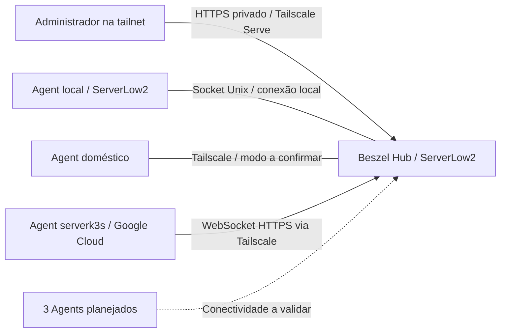

# Observabilidade de baixo custo com Beszel

Monitoramento de uma infraestrutura híbrida com **Beszel**, Docker Compose e Tailscale: métricas centralizadas, acesso privado e uma operação adequada a servidores com poucos recursos.

O Hub está em uma Oracle Cloud Micro com **1 vCPU e 1 GB de RAM**. O projeto documenta implantação, decisões, diagnóstico de falhas e medição de consumo. O objetivo é demonstrar uma solução operável e reproduzível; o baixo consumo ainda precisa ser quantificado por uma campanha de medições.

## Arquitetura



O diagrama descreve comunicação lógica, não regras de firewall. Beszel acompanha recursos dos hosts e containers quando configurados; logs centralizados, tracing, APM e métricas específicas de Kubernetes ficam fora desta implantação.

## Estado do projeto

| Host | Papel | Estado e evidência |
|---|---|---|
| ServerLow2 / Oracle | Hub e Agent local | Instalados; painel compartilhado pelo usuário mostra host online |
| Servidor doméstico | Agent; aplicações Docker em produção | Painel compartilhado pelo usuário mostra host online |
| serverk3s / Google Cloud | Agent remoto | Conexão confirmada pelo usuário após correção de DNS |
| Novos hosts 1, 2 e 3 | Agents adicionais | Pendentes; identidades a confirmar |

São **três hosts monitorados documentados e três expansões pendentes**. Não há inspeção remota independente nesta etapa. ServerLow1 e AWS são candidatos conhecidos, sem associação automática às vagas. Inventário e critérios de aceite: [docs/inventario.md](docs/inventario.md).

## Navegação

| Material | Finalidade |
|---|---|
| [Guia de instalação](comandos.md) | Hub, Agent local e cadastro de Agents remotos |
| [Arquitetura e decisões](docs/arquitetura.md) | Escolhas, limites e pontos de falha |
| [Inventário e expansão](docs/inventario.md) | Estado, critérios de aceite e três novos hosts |
| [Operação](docs/operacao.md) | Diagnóstico, atualização, alertas e recuperação |
| [Consumo e custo](docs/consumo-e-custo.md) | Método de medição e resultados ainda pendentes |
| [Segurança e publicação](docs/seguranca.md) | Rede, credenciais, socket Docker e revisão antes de publicar |
| [Incidente de DNS](docs/incidentes/001-dns-agent-gcp.md) | Sintoma, causa, correção e validação |
| [Evidências visuais](assets/screenshots/README.md) | Prints necessários e critérios de anonimização |
| [Scripts](scripts/README.md) | Diagnóstico somente de leitura e testes |

## Configuração reproduzível

- [docker-compose.yml](docker-compose.yml): Hub e Agent local. Publicação do Hub em `127.0.0.1:8090`, persistência local e reinício automático.
- [.env.example](.env.example): variáveis do Hub; copie apenas para uma instalação nova, sem sobrescrever credenciais existentes.
- [deploy/agent/compose.yml](deploy/agent/compose.yml) e [modelo de ambiente](deploy/agent/.env.example): Agent remoto com WebSocket, DNS Tailscale e SSH interno desativado. Instalação detalhada no [guia](comandos.md).

Os modelos usam `latest`, como a instalação atual. Registre a versão/digest executada antes de atualizar; tags flutuantes não garantem reprodução de uma versão exata.

## Verificação local

Sem instalar dependências ou acessar servidores:

```bash
bash tests/check-scripts.sh
```

Nos hosts, sob demanda, os scripts coletam estado e verificam o HTTPS do Hub. Não modificam serviços, firewall ou configurações. Revise a saída antes de publicá-la.

## Próximas entregas

1. Identificar e cadastrar os três novos hosts, validando um por vez.
2. Medir consumo do Hub e Agents em condições documentadas.
3. Configurar e testar alertas essenciais e recuperação de backup.
4. Publicar prints revisados e resultados com data, versão e limitações.

Os documentos [OBSERVABILIDADE_BESZEL.md](OBSERVABILIDADE_BESZEL.md) e [info.md](info.md) preservam o contexto original e podem conter estados anteriores. O inventário acima registra a evolução desta implantação.

O repositório ainda contém `terraforms.tf`, uma exportação de contexto da VM Google Cloud, sem gerenciamento por state confirmado. Ele não integra o procedimento Beszel; não execute `terraform apply` como parte deste guia.

**Revisão de publicação:** IPs administrativos, caminhos pessoais de chaves, hostname privado e identificadores GCP conhecidos foram substituídos por exemplos nos arquivos locais e no histórico Git local. A atualização do histórico no remoto ainda está pendente; clones e cópias externas não são limpos automaticamente. Nenhum screenshot com token deve ser publicado.
